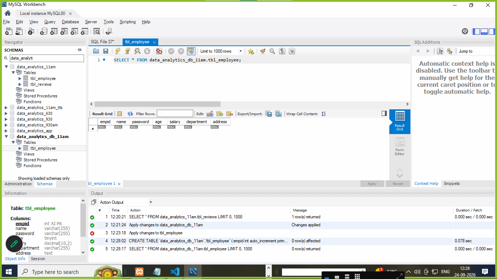
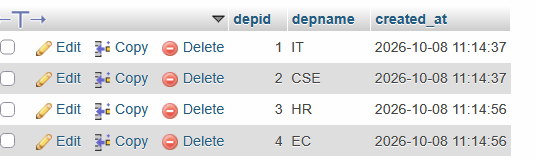
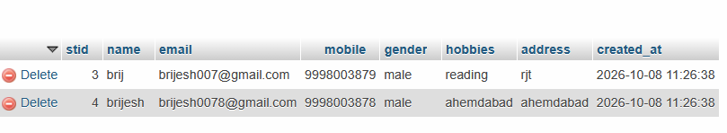
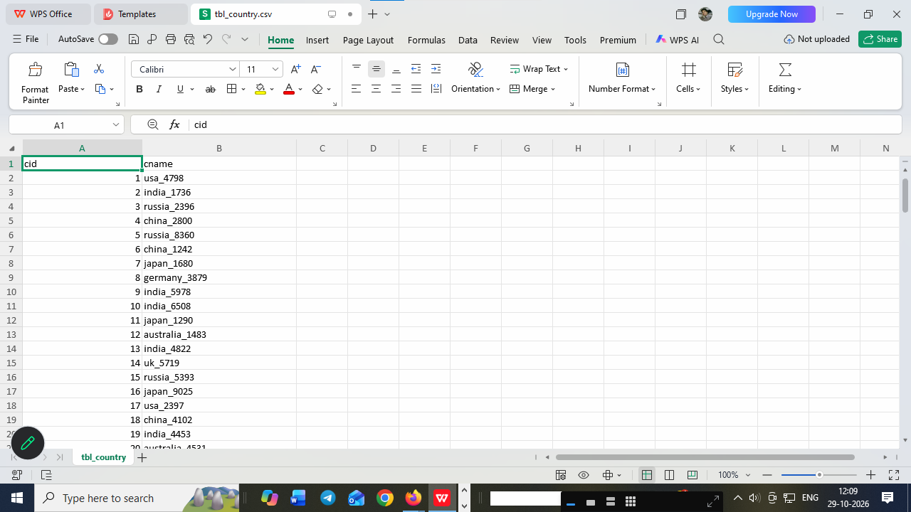
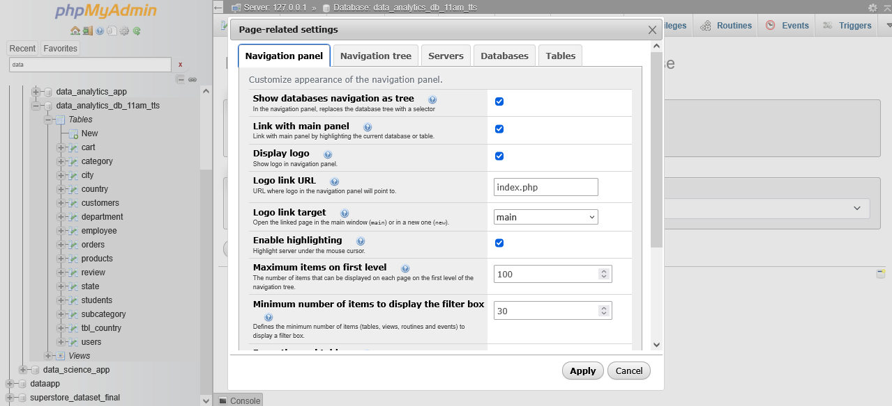

# what is SQL ?

1. SQL stands for **structured query language**
2. SQL used for create database | tables structured  
3. SQL is a case insenstive query language
**examples**
```
insert | INSERT | Insert
```
4. SQL is used to create structured of database and tables via its **query or command**
5. SQL is create logics and functional
6. SQL execute query 
7. SQL create views or index to fast load data 
8. SQL create a structured data 

**structured data formate column and rows**
**examples**

|   id      |   name       |     age     |    address     |
|-----------|--------------|-------------|----------------|
|  1        |    mansi     |     25      |    rjt         |
|  2        |    mansi     |     25      |    rjt         |
|  3        |    mansi     |     25      |    rjt         |
|  4        |    mansi     |     25      |    rjt         |
|  5        |    mansi     |     25      |    rjt         |  


# types of SQL query or commands 

1. **DDL (data definition language)**
2. **DML (data manipulation language)**
3. **DQL (data query language)**
4. **TCL (transactional control language)**


# DDL (data definition language)

1. stands for data definition language
2. create an structured of database and tables 
3. rename tables 
4. update | add | modify | drop data in tables or columns in tables 
5. truncate data from tables 

**DDL query are**

1. create 
2. alter 
3. rename 
4. drop 
5. truncate 
6. change 

# how to create database and table structured 

1. create a database 

**syntax**

```
create database databasename;
```

**examples**

```
create database data_analytics_11am
```

2. create a table  structured

**syntax**

```
create table tablename
(
id datatype (size) auto_increment primary key,
columnname datatype (size),
.
.
.
.
.
.
columnname datatype(size)
);

```

**examples**

```
create table tbl_employee(
empid int AUTO_INCREMENT primary key,
name varchar(255),
age int,    
address text, 
salary decimal(10,2),
city varchar(100),
department varchar(200)   
);

```

# what is datatypes and size of column name is tables 

| Column / Field | Data Type | Description |
|---|---|---|
| name | CHAR(0–255) | Stores fixed-length character/string data. Intended for characters/text only. |
| name | VARCHAR(0–255) | Stores variable-length character/string data. Can contain letters, numbers, spaces, and special characters. |
| id | INT | Stores whole numbers, commonly used for IDs and numeric values. |
| bigint_id | BIGINT | Stores very large whole numbers, commonly used for large IDs. |
| age | TINYINT | Stores small whole numbers, commonly used for values such as age. |
| amount | DECIMAL(p,s) | Stores exact decimal numbers, commonly used for money and financial values. |
| price | FLOAT | Stores approximate decimal/floating-point numbers. |
| percentage | DOUBLE | Stores approximate decimal numbers with higher precision than FLOAT. |
| is_active | BOOLEAN | Stores a true/false value. |
| status | ENUM | Stores one value from a predefined list of allowed values. |
| description | TEXT | Stores variable-length text without a small VARCHAR-style limit. |
| long_description | LONGTEXT | Stores very large amounts of text. |
| code | CHAR(n) | Stores fixed-length text. Useful for values with a known, consistent length, such as country codes. |
| email | VARCHAR(255) | Stores email addresses as variable-length text. |
| phone | VARCHAR(20) | Stores phone numbers. VARCHAR is preferred because phone numbers may contain `+`, spaces, `-`, etc. |
| url | VARCHAR(2048) | Stores website or URL strings. |
| date_of_birth | DATE | Stores a calendar date in `YYYY-MM-DD` format. |
| created_at | DATETIME | Stores date and time without timezone conversion. |
| updated_at | TIMESTAMP | Stores a date and time, commonly used for record creation/update timestamps. |
| time | TIME | Stores a time value such as `14:30:00`. |
| year | YEAR | Stores a year value. |
| json_data | JSON | Stores structured JSON data. |
| binary_data | BLOB | Stores binary data such as files or raw bytes. |
| uuid | CHAR(36) | Stores a UUID string such as `550e8400-e29b-41d4-a716-446655440000`. |


**create a 5 tables**

**tbl_reviews**

```
create table tbl_reviews(

rid int AUTO_INCREMENT primary key,
name varchar(250),
email varchar(255),
phone bigint,
rating enum('*','**','***','****','*****'),
COMMENT text

)

or

create table tbl_users
(
uid int AUTO_INCREMENT primary key,
name varchar(255),
email varchar(255),
password varchar(255),
gender enum('male','female','other'),
photo blob,
address text,
pincode tinyint,
created_at varchar(255)    

)

```

# create the thinks in workbench database 
# work bench view



```
CREATE TABLE `data_analytics_db_11am`.`tbl_employee` (
empid int auto_increment primary key,
name varchar(255),
password varchar(255),
age tinyint,
salary decimal(10,2),
department varchar(255),
address text

);
```


# alter : 

1. alter is used to add new column after create a table 
2. alter is used to modify | rename | or delete a column name is table 
3. alter is used to add unique key of any column name 

**examples**

1. alter table tbl_employee add country varchar(255);
2. alter table tbl_employee add state varchar(255);
3. alter table tbl_employee add city varchar(255);
4. alter table tbl_employee add photo blob after name;
5. ALTER TABLE tbl_users
ADD COLUMN country VARCHAR(255) AFTER pincode,
ADD COLUMN state VARCHAR(255) AFTER country,
ADD COLUMN city VARCHAR(255) AFTER state;
6. alter table tbl_users change photo  upload_photo blob;
7. alter table tbl_users drop created_at;
8. alter table tbl_users add UNIQUE(`email`);

# rename table:
1. after create table via SQL we can changed a table name via **rename**
**examples**
```
rename table tbl_country to country
or
rename table tbl_users to users

```

# rename database name :

```  
CREATE DATABASE IF NOT EXISTS data_analytics_db_11am_tts;
DROP DATABASE IF EXISTS data_analytics_db_11am;

```
# change :

1. change is a **keyword** that can be changed the column name of table

**examples**

```
alter table employee change photo upload_photo blob;
```


# drop : 

1. drop is used to drop database after drop we can not rollback 
2. drop is also used to drop table after drop we never rollback data or its structures 
3. drop is also delete a column name 

# note : after drop we never rollback

**examples**

```
drop database data_analytics_db_11am_tts;
or
drop table users;
or 
drop table users
or
alter table users drop upload_photo;
or 
ALTER TABLE users
DROP COLUMN `state`,
DROP COLUMN `city`;

```

# truncate :

1. truncate is used to empty all data from tables 
2. after truncate we never rollback data from tables

**examples**

```
truncate table users;
or 
truncate table review
```
# after truncate we never rollback data

# **DML (data manipulation language)**

1. DMl is used to insert single data or multiple data in tables 
2. DMl is used to delete all data or particular one data or alternate data or range of data from tables
3. DMl is used to update single data or multiple data in tables 

**examples**

1. **insert a single data or row**
**examples**

```
insert into country (cname,created_at) values('india','29/09/2026')
```

2. **insert a multiple data or row**
**examples**

```
insert into country (cname,created_at) values('usa','29/09/2026'),('australia','29/09/2026'),('uk','29/09/2026'),('iran','29/09/2026')

or
insert into country (cname,created_at) values('usa','29/09/2026'),('australia','29/09/2026'),('uk','29/09/2026'),('iran','29/09/2026')
or

insert into country values(null,'canada','29/09/2026'),(null,'thailand','29/09/2026'),(null,'china','29/09/2026'),(null,'japan','29/09/2026')

or

INSERT into employee values(null, 'smith','smith.jpg','s254545',21,14500,'IT','150 rajkot','india','gujrat','rajkot'),(null, 'rushikesh','rushi.jpg','r254545',22,15500,'IT','150 rajkot','india','gujrat','rajkot'),(null, 'priyanshu','p.jpg','p254545',24,16500,'CSE','150 rajkot','india','gujrat','junagad'),(null, 'ashtha','astha.jpg','a254545',25,16500,'CSE','150 rajkot','india','gujrat','jamanagar'),(null, 'mansi','mansi.jpg','m254545',24,18500,'IT','150 feet ring road lucknow','india','uttar pradesh','lucknow')

```

**update data or row**

1. update a single data 
**examples**
```
update country set cname='america' where cid=9;
or
update country set cname='bharat', created_at='27/09/2026' where cid=1;

```

**delete data or rows**

1. delete all data 
**examples**
```
delete from country;
```
2. delete one  data from table 
**examples**
```
delete from country where cid=2;
```

3. delete one  data from table via its name 
**examples**
```
delete from country where cname='america';
```

4. delete alternate  data from table 
**examples**
```
delete from country where cid in (2,4,6);
```

5. delete range of   data from table 
**examples**
```
delete from country where cid between 100 and 255;
```


# DQL (data query language)
**DQL only used **select** keyword to fetch or retrieve data from tables


1. DQL is used to fetch or retrieve data from tables
2. DQL is used to fetch data from single table or multiple tables via join query
3. DQL is used to select data from tables using **select** keyword
4. DQL is also used to filter data from tables using **where** keyword
5. select is also used to fetch or filter data in order by ascending or descending order using **order by** keyword
6. select is also used to fetch or filter data in group by using **group by**
7. select is also used to select range of from tables using **between** keyword
8. select alternative data from tables using **in** keyword
9. select data from tables using **like** keyword it is also used to search data from tables using **%** and **_** keyword or wildcard
10. select data from tables using **distinct** keyword it is also used to fetch unique data from tables
11. select data from tables using **limit** keyword it is also used to fetch limited data from tables.
12. select data from tables using **join** keyword it is also used to fetch data from multiple tables via join query
13. select data from tables using **union** keyword it is also used to fetch data from multiple tables via union query
14. select data from tables using **subquery** keyword it is also used to fetch data from multiple tables via subquery

**examples**
```
subquery means query inside query

```
15. select data from tables using **alias** keyword it is also used to fetch data from multiple tables via alias query

**examples**
```
alias means rename a column name or table name via select query
alias used keyword **as** to rename a column name or table name

``` 

16. select data from tables using **aggregate functions** keyword it is also used to fetch data from multiple tables via aggregate functions query

**examples of aggrigate functions**
```
1) max() - it is used to fetch maximum value from tables
2) min() - it is used to fetch minimum value from tables
3) sum() - it is used to fetch sum of values from tables
4) avg() - it is used to fetch average of values from tables
5) count() - it is used to fetch count of values from tables

```

17. select used in scalar functions to fetch data from tables using **scalar functions** keyword it is also used to fetch data from multiple tables via scalar functions query

**examples of scalar functions**
```
1) upper() - it is used to convert data in uppercase from tables
2) lower() - it is used to convert data in lowercase from tables
3) length() - it is used to fetch length of data from tables
4) round() - it is used to round the decimal values from tables
5) now() - it is used to fetch current date and time from tables
6) curdate() - it is used to fetch current date from tables
7) curtime() - it is used to fetch current time from tables

```

18. select used in date functions to fetch data from tables using **date functions** keyword it is also used to fetch data from multiple tables via date functions query

**examples of date functions**
```
1) date() - it is used to fetch date from datetime values from tables
2) time() - it is used to fetch time from datetime values from tables
3) year() - it is used to fetch year from datetime values from tables
4) month() - it is used to fetch month from datetime values from tables
5) day() - it is used to fetch day from datetime values from tables
6) datediff() - it is used to fetch difference between two dates from tables
7) date_add() - it is used to add days, months, years to a date value in tables
8) date_sub() - it is used to subtract days, months, years from a date value in tables

```
19. select used in string functions to fetch data from tables using **string functions** keyword it is also used to fetch data from multiple tables via string functions query

**examples of string functions**
```
1) concat() - it is used to concatenate two or more strings from tables
2) substring() - it is used to fetch a substring from a string value in tables
3) replace() - it is used to replace a substring with another substring in a string value in tables

4) trim() - it is used to remove leading and trailing spaces from a string value in tables

5) instr() - it is used to find the position of a substring in a string value in tables

```

20. select used in mathematical functions to fetch data from tables using **mathematical functions** keyword it is also used to fetch data from multiple tables via mathematical functions query

**examples of mathematical functions**
```
1) abs() - it is used to fetch absolute value of a number from tables

2) ceil() - it is used to fetch the smallest integer greater than or equal to a number from tables

3) floor() - it is used to fetch the largest integer less than or equal to a number from tables

4) power() - it is used to fetch the power of a number from tables

5) sqrt() - it is used to fetch the square root of a number from tables

```

**examples of DQL query**

1. select all data from table

```
select * from tablename;
or
select * from employee;
```
2. select particular column name from table

```
select columnname from tablename;
or
select empid,name,age,salary from employee;

```

3. select data of 1 rows 

**where** keyword is used to filter data from tables

```
select * from tablename where columnname=value;
or
select * from employee where name='mansi';
or
select * from employee where empid=1;
or
select * from employee where empid=1 and name='smith';
or
select * from employee where empid=1 or name='mansi';
```

# select range of data from tables using **between** keyword

```
select * from employee where empid between 1 and 4;

```
# select alternative data from tables using **in** keyword

```
select * from employee where empid in (2,3,5);
or
select * from employee where name in ('smith','mansi');
or
select * from employee where empid not in (2,3,5);
or
select * from employee where name not in ('smith','mansi');
or
select * from employee where age in (25,30,35);
```
# select data using limit keyword to fetch limited data from tables

```
select * from employee limit 3;
or
select * from employee limit 4;
or
select * from employee limit 6;
or
select * from employee limit 1,4;
or
select * from employee limit 0,4;
or
select * from employee limit 7,8;
```
# select data using like keyword to fetch data from tables

**like** keyword is used to search data from tables using **%** and **_** keyword or wildcard

```
select * from employee where name like 'a%';
or
select * from employee where name like '%h';
or
select * from employee where name like '%h';
or
select * from employee where name like '%m%';
or
select * from employee where name like '%a%';
or
select * from employee where name like '_m%';
or
select * from employee where name like '____h';
or
select * from employee where name like '____%h';

```

**list out all types of keywords used in SQL query**

1. select
2. from
3. where
4. order by
5. group by
6. having
7. limit
8. distinct
9. in
10. between
11. like
12. join
13. union
14. subquery
15. alias
16. aggregate functions
17. scalar functions
18. date functions
19. string functions
20. mathematical functions
21. insert
22. update
13. delete
14. alter
15. rename
16. drop
17. truncate
18. create
19. change
20. add

# how to rename a column name in table using **alias** keyword

1. alias is used to rename a column name in table using **as** keyword

```
select name as employee_name from employee;
or
select empid, name as employee_name from employee;
or
select empid, name as employee_name, address as employee_address from employee;
or
select cname as country_name from tbl_country;

```
# select a range of data 

1. select * from country limit 0,15
2. select * from country where cid between 1 and 8;
3. select * from country where cname in ('bharat','usa','uk');

# SQL function 
There are two types of sql function
1. Aggrigate function

- sum()
- avg()
- max()
- min()
- count()

2. scalar function 

- first()
- last()
- lcase()
- ucase()
- now ()
**examples**

1. select sum(salary) as sum_of_salary from employee;
2. select sum(salary) as sum_of_salary from employee where empid in (1,4,5);
3. select sum(salary) as sum_of_salary from employee where empid limit 0,4;
4. select sum(salary) as sum_of_salary from employee where empid limit 0,4
5. select sum(salary) from employee where salary>17500 and salary < 20500;

6. select avg(salary) as avg_of_salary from employee;
7. select max(salary) as max_of_salary from employee
8. select min(salary) as min_of_salary from employee
9. select count(empid) as total_number_employee from employee

# group by :

1. group by is used to filter data on group of columns there we used group by 

2. **having** is a cluse that can be used with aggrigate function but always after **group by** 

```
select sum(salary), department from employee GROUP by department;
or
select sum(salary), department from employee GROUP by department having department='IT';
or
select sum(salary), department from employee GROUP by department having department='CSE';
or
select sum(salary), department from employee GROUP by department having department='EC'; 

```

# scalar function :

1. select first(empid) from employee;
2. select last(empid) from employee;
3. select lcase(name) from employee;
4. select ucase(name) from employee;
5. select now() from employee;

# what is difference b/w delete | truncate | drop 


| Command | What it removes | Can filter rows? | Table remains? |
|---|---|---:|---:|
| `DELETE` | Selected rows, or all rows if no `WHERE` | Yes | Yes |
| `TRUNCATE` | All rows in a table | No | Yes |
| `DROP` | The table itself, including its data and structure | No | No |

```sql
DELETE FROM employees WHERE department = 'Sales'; -- remove matching rows
DELETE FROM employees;                            -- remove all rows

TRUNCATE TABLE employees;                         -- empty the table

DROP TABLE employees;                             -- remove the table
```

**In short:** `DELETE` removes rows selectively, `TRUNCATE` quickly empties a table, and `DROP` removes the table. Exact behavior—such as rollback support, identity-counter resets, and trigger behavior—can vary by database system.


# TCL : 
1. TCL stands transactional control language
2. TCL is used to commit and rollback data from tables 
3. TCL is used to same data after delete 
4. TCL is used to rollback data after delete

# queries in TCL 

1. commit 
2. rollback 

**commit**

1. commit used to save data after delete 
2. commit is used in TCL 

**query of commit**

```
start TRANSACTION;
delete from country where cid=9;
commit;


```

**rollback**

1. rollback used to rollback data after delete 
2. rollback is used in TCL 

**query of rollback**

```
start TRANSACTION;
delete from country where cid=8;
select * from country where cid=8;
rollback;
select * from country where cid=8;
```

# key constraints in SQL : 

1. key constraints provides limitations on tables 
2. key constraints provides pk | uk | fk on tables 

# types of key constraints  in SQL 

# primary key : 

1. pk is provides one times in a tables 
2. pk never stored null values 
3. pk should always auto_increments 

**create table**

```
create table department(

depid int auto_increment primary key,
depname varchar(200),
created_at timestamp
)


```




# unique key : 

1. uk is provides more than one times in a tables on column 
2. uk at least stored one times a null values 
3. uk never stored dublicate data 

**create table**

```

create table students(

stid int auto_increment primary key,
name varchar(200),
email varchar(200),
mobile bigint,
gender varchar(200),
hobbies varchar(200),   
address text,
created_at timestamp
)

```
# how to create unique key on tables 

```
alter table students add UNIQUE KEY(`email`)
or
alter table students add UNIQUE KEY(`email`, `mobile`)

```





# foreign key : 

1. fk is provides more than one times in a tables on column 
2. fk stored a dublicate data  
3. fk used to provides relationship b/w one table to another tables with common field or columns in tables  

**create table**

```
create table country(

cid int AUTO_INCREMENT PRIMARY key, 
cname varchar(255),
created_at timestamp

)

or

create table state(

sid int AUTO_INCREMENT PRIMARY key, 
sname varchar(255),
created_at timestamp

)

or

create table city(

ctid int AUTO_INCREMENT PRIMARY key, 
ctname varchar(255),
created_at timestamp

)

or

create table users(

uid int AUTO_INCREMENT PRIMARY key, 
name varchar(255),
email varchar(255),
mobile bigint,
gender varchar(255),
hobby varchar(255),
cid int,
CONSTRAINT FOREIGN key(cid) REFERENCES country(cid),
sid int,
CONSTRAINT FOREIGN key(sid) REFERENCES state(sid),
ctid int,
CONSTRAINT FOREIGN key(ctid) REFERENCES city(ctid),
address text,
created_at timestamp

)

```

# SQL Normalization  ?

1. SQL normalization is used to removed dublicate or redundancies formate of data in tables 
2. SQL normalization is used to devide tables using pk | uk | fk to removed dublicacy data formate in tables 
3. There are some types of normalization 

# types of nomalization 

1. 1 NF (normalization form) 
2. 2 NF (normalization form)
3. 3 NF (normalization form)
4. 4 NF (normalization form)
5. 5 NF (normalization form)

# 1 NF normalization form 

- simple create tables and provides primary key without relationship 
- this is called 1 NF 
- create a table of college 


```
create table tbl_college(
collegeid int primary key AUTO_INCREMENT,
collegename varchar(255)
)

or

create table tbl_department(
depid int primary key AUTO_INCREMENT,
depename varchar(255)
)

```

# 2 NF (normalization form)
1. create a table and add some table of columns as pk and uk 
2. create table and add some uk to not accept dublicate data 

```
create table tbl_faculty(
fid int primary key AUTO_INCREMENT,
name varchar(255),
email varchar(255),
age int,
address text,
mobile bigint    
)

```
# 3 NF (normalization form)

1. 3 NF start to provides relationship b/w tables 
2. 3 NF provides FK for common field to give relationship b/w tables 

```
create table tbl_students(
stid int primary key AUTO_INCREMENT,
studentname varchar(255),
stdemail varchar(255),
stdage int,
stdaddress text,
stdmobile bigint,    
depid int,
CONSTRAINT FOREIGN key(depid)  REFERENCES tbl_department(depid),
fid int,
CONSTRAINT FOREIGN key(fid)  REFERENCES tbl_faculty(fid),

collegeid int,
CONSTRAINT FOREIGN key(collegeid)  REFERENCES tbl_college(collegeid)

);

```

# SQL join :  
1. SQL join are used to join more than one tables with common field 
2. SQL join is used to join with match field one table to another table join that data 
3. SQL join  are some types 


# types of join 
1. join 
2. inner join 
3. outer join 
- left join 
- right join 
- full join (not supported in mySql)
4. union join
5. cross join 
6. self join 

#  join : 
1. SQL join are used to join more than one tables with common field 
2. SQL join is used to join with match field one table to another table join that data 
3. join are used by **join** keyword 


**syntax of join**
```

select table1.*, columnname from table1 join table2 on table1.commoncolumndname = table2.commoncolumnname

or
select users.*, cname from users join country on users.cid=country.cid;

or

select users.*, cname , sname, ctname  from users join country on users.cid=country.cid join state on users.sid=state.sid join city on users.ctid=city.ctid;


```

# inner join : 

1. SQL inner join are used to join more than one tables with common field 
2. SQL inner join is used to join with match field one table to another table join that data and return all data of first table and also join matched data

3. inner join are used by **inner join** keyword 

**syntax of inner join**

```
select table1.*, columnname from table1 inner join table2 on table1.commoncolumndname = table2.commoncolumnname
or
select users.*, cname from users inner join country on users.cid=country.cid;
or
select users.*, cname , sname, ctname  from users inner join country on users.cid=country.cid inner join state on users.sid=state.sid inner join city on users.ctid=city.ctid;
or
select uid, name, email, mobile, cname , sname, ctname  from users inner join country on users.cid=country.cid inner join state on users.sid=state.sid inner join city on users.ctid=city.ctid;

or

select orders.*, first_name, product_name from orders inner join customers on orders.customer_id=customers.customer_id inner join products on orders.product_id=products.product_id;

or

select orders.*, first_name, email, product_name from orders inner join customers on orders.customer_id=customers.customer_id inner join products on orders.product_id=products.product_id;

```

# outer join :

1. left join 
2. right join 
3. full join 

# left join : 

1. SQL left join are used to join more than one tables with common field 
2. SQL left join is used to join with match field of first table of left rows and return all data of first table and matched with second table of left rows if data matched return all data otherwise return null values there we used left join 

3. left join are used by **left join** keyword 

**syntax**

```
select table1.*, columnname from table1 left join table2 on table1.commoncolumndname = table2.commoncolumnname

or
select users.*, cname from users left join country on users.cid=country.cid;
or
select users.*, cname , sname, ctname  from users left join country on users.cid=country.cid left join state on users.sid=state.sid left join city on users.ctid=city.ctid;
or
select uid, name, email, mobile, cname , sname, ctname  from users left join country on users.cid=country.cid left join state on users.sid=state.sid left join city on users.ctid=city.ctid;

or

select orders.*, first_name, product_name from orders ileft join customers on orders.customer_id=customers.customer_id left join products on orders.product_id=products.product_id;

or

select orders.*, first_name, email, product_name from orders left join customers on orders.customer_id=customers.customer_id left join products on orders.product_id=products.product_id;

```

# right join : 

1. SQL right join are used to join more than one tables with common field 
2. SQL right join is used to join with match field of second table of right rows and return all data of second table and matched with first table of right rows if data matched return all data otherwise return **null** values there we used right join 

3. right join are used by **right join** keyword 

**syntax**

```
select table1.*, columnname from table1 right join table2 on table1.commoncolumndname = table2.commoncolumnname

or
select users.*, cname from users right join country on users.cid=country.cid;
or
select users.*, cname , sname, ctname  from users right join country on users.cid=country.cid right join state on users.sid=state.sid right join city on users.ctid=city.ctid;

or

select uid, name, email, mobile, cname , sname, ctname  from users right join country on users.cid=country.cid right join state on users.sid=state.sid right join city on users.ctid=city.ctid;

or

select orders.*, first_name, product_name from orders right join customers on orders.customer_id=customers.customer_id right join products on orders.product_id=products.product_id;

or

select orders.*, first_name, email, product_name from orders right join customers on orders.customer_id=customers.customer_id right join products on orders.product_id=products.product_id;

```

# full join : not supported inside of mysql 
# full join =left join + right join 
# note : we used union  join instead of full join  

# unioun join : 

# examples :

```
select users.*, cname from users left join country on users.cid=country.cid
union
select users.*, cname from users right join country on users.cid=country.cid 

```

# cross join : 

1. cross join are used to join more than one table and its cross of return data from one table to another table
2. its return a multiplication of each rows to another table data
3. its return a dublicate data either match or not 

# examples 
```
select * from users cross join country;
```

# its used in chain marketing 

```
A
B    C     D
EFG  HIJ   KLM   

```

# w.a.q to find second highest slalry from employee using subquery 
1. subquery are used to query within another query 
2. subquery are used to find above answer 
3. fond highest salary
# examples
```
select max(salary) as second_highest_salary from employee where salary<(select max(salary) from employee)
or 
select max(salary) as highest_salary from employee

```
# w.a.q to find second highest salary from employee using limit 
# examples 
```
select salary as second_highest_salary from employee ORDER by salary desc limit 1,1;
or
select salary as max_highest_salary from employee ORDER by salary desc limit 0,1;
or
select salary as third_highest_salary from employee ORDER by salary desc limit 2,1;

```
# w.a.q to find a sum of salary on department wise 
```
select sum(salary), department as sumof_salary_department from employee group by department;
```

# w.a.q to alis of any column name 
```
select name as employee_name from employee 
```
# w.a.q to find systems default date and time via sql query 
```
select now()
or
select CURRENT_DATE()
or
select CURRENT_TIME()
```
# w.a.q to search any name in tables start with 's' or 'a' or 'b'

```
select * from employee where name like 's%';
or
select * from employee where name like 'a%';
or
select * from employee where name like 'b%';
or
select * from employee where name like '%s';
or
select * from employee where name like '%a%';
```
# self join : 

# def : 

1. self join are used to join with itself 
2. self join are not used another tables but used itself to join with common field or matched data 

```
select e.empid ,e.name as employeename , m.manager as manager_name from employee e join employee m on e.empid=m.empid; 

```

# SQL View  :  

1. sql view are used to create a dublicate table of main tables 
2. sql view create a clone tables of main tables 
3. sql view is used to hide some data from some users there we create a view 
4. view is create a clone of main tables and we create to insert | delete | update any new data inside of clone tables it will be effected in main tables also. 
5. sql view create a virtual tables of main table 

**examples of syntax**
```
create view viewane as select columnamename1, columnname2  from tablename;
or 
create view viewane as select columnamename1, columnname2  from tablename where name in ('smith','mansi');
or 
create view viewane as select columnamename1, columnname2  from tablename where id in (1,5);

```

# SQL indexer or index : 
1. indexer create to perfomed speed optimized of tables 
2. indexer create to performed 10x fast load data from tables 
3. indexer create to fast lookups or search data from tables 

# types of indexer 
1. there are two types of indexer 
2. create an indexer after can not create a indexer with sam name 

- single indexer (if create on single columns of tables)
- composite indexer (if create more than one columns composite indexer)

# how to create indexer 

```
create index indexname on tablename (columnname1);
or 
create index indexname on tablename (id,name,salary, department);
or
create index indexname_employee1 on employee(name);
or
create index indexname_employee2 on employee(empid,name,age,salary,department);
```

# SQL string function  :

1. manupulating string inside of tables there we used string function 
2. its is manipulating a string in sql 

# examples of string function ...

- length()
- upper()
- concat()
- lower()
- trim()
- replace()
- right()
- left()


# examples of string function 

1.  select length('rushikesh') from employee where empid=2;
2. select length(name) from employee;
3. select length(name) from employee where name='smith';
4. select upper(name) from employee;
5. select lower(name) from employee;
6. select concat(name,lname) from employee
7. select trim(name) from  employee where empid=5; 
8. select replace('pizza liked by ashtha','ashtha','babbu bhai') from employee where empid=4;
**left right syntax**
```
LEFT(string, number_of_characters)
RIGHT(string, number_of_characters)
```
9. select left(name, 9) from employee; 
10. select right(name, 9) from employee; 


# w.a.q to stored a 10k data to check a speed of tables 

**examples**

```

INSERT INTO tbl_country (cname)
SELECT CONCAT(
    ELT(
        FLOOR(1 + RAND() * 9),
        'india',
        'usa',
        'germany',
        'australia',
        'china',
        'russia',
        'japan',
        'brazil',
        'uk'
    ),
    '_',
    FLOOR(1000 + RAND() * 9000)
)
FROM (
    SELECT 1
    FROM information_schema.columns a
    CROSS JOIN information_schema.columns b
    LIMIT 20000
) AS x
WHERE ELT(
    FLOOR(1 + RAND() * 9),
    'india', 'usa', 'germany', 'australia', 'china',
    'russia', 'japan', 'brazil', 'uk'
) IS NOT NULL;
 
               
```

# screenshot of data in CSV or .xlsx or .json  or xlsx formate 



# screenshot of data in .sql




# SQL windows function ................

# SQL CTE (common table expression)

