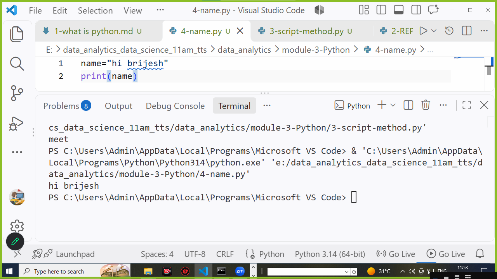
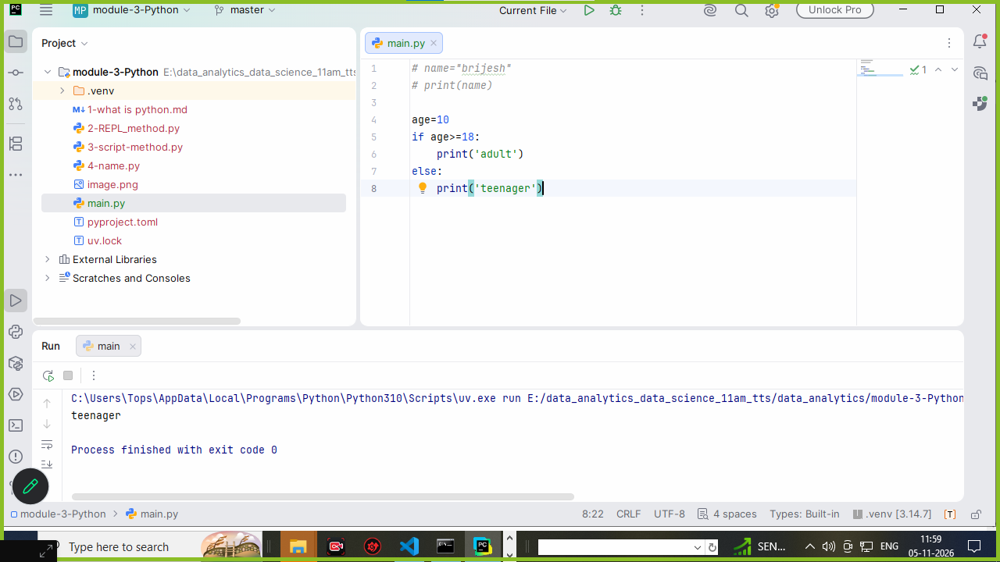
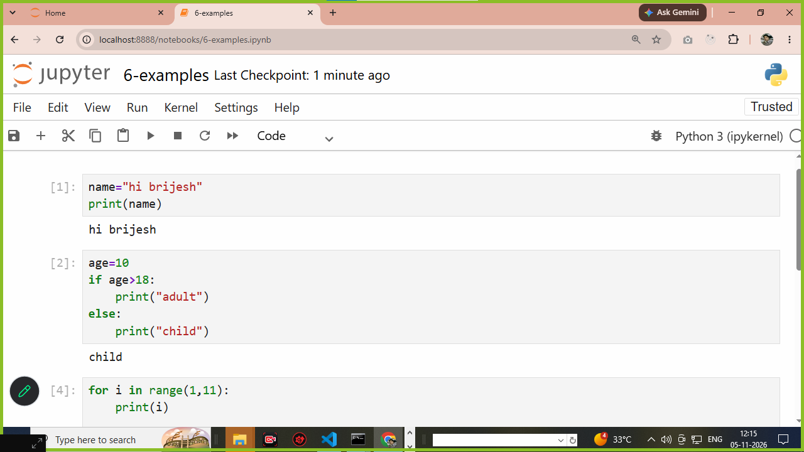

# what is python ? 

1. python is a language 
2. python is interpreter based language 
3. python is most powerful language used for ...

   - web development 
   - machine learning 
   - data analytics 
   - business analytics 
   - data science 
   - agentic ai 
   - generative ai 
   - desktop app development 
   - iot 
   - cyber security

4. python interpreter the programmes step by step checked proggrames and also interpreter convert high level language to binary level language 

5. python is a programming language
6. python used for web development and data analytics and data science also
7. python most powerful language that is again number one positions in language

8. python are used to save with .py file extension 
9. python is also save with .ipynb if we used jupyter notebook  
10. python is case-senstive language
   **examples**
   ```
   print()
   or 
   pandas
   or
   calendar
   or 
   class
   or
   numpy 

   ```
11. how to run python 
**there are two method to run python**

    - REPL (read | evaluate | print | loop) method 
    - script method 

12. how to check python is installed or not 

```
E:\data_analytics_data_science_11am_tts\data_analytics\module-3-Python>python
Python 3.14.7 (tags/v3.14.7:823f032, Aug  5 2026, 10:51:32) [MSC v.1944 64 bit (AMD64)] on win32
Type "help", "copyright", "credits" or "license" for more information.

```

13. using script we can save file with .py and write a programmes in python 

**examples**
```
# name='my name is brijesh'
# print(name)

# age=18
# if age>=18:
#     print('i am adult')
# else:
#     print('i am child')

# for i in range(1,51):
#     print(i)

name="meet"
print(name)

```

14. python used some different-2 IDE to run programmes 

    1. VS code
    2. pycharm 
    3. jupyter 

# python run on vs code 



# python run on pycharm 



# python run on jupyter



