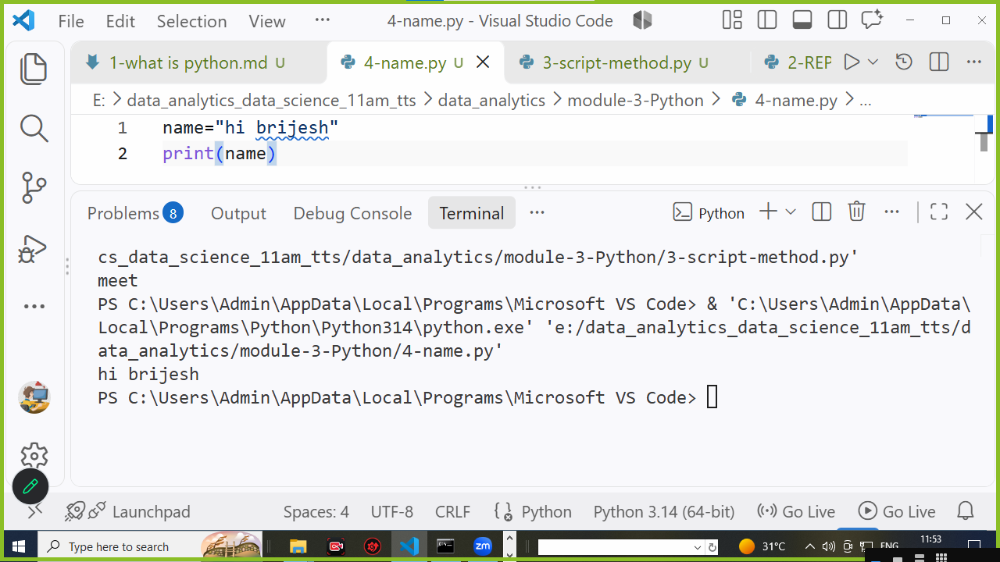
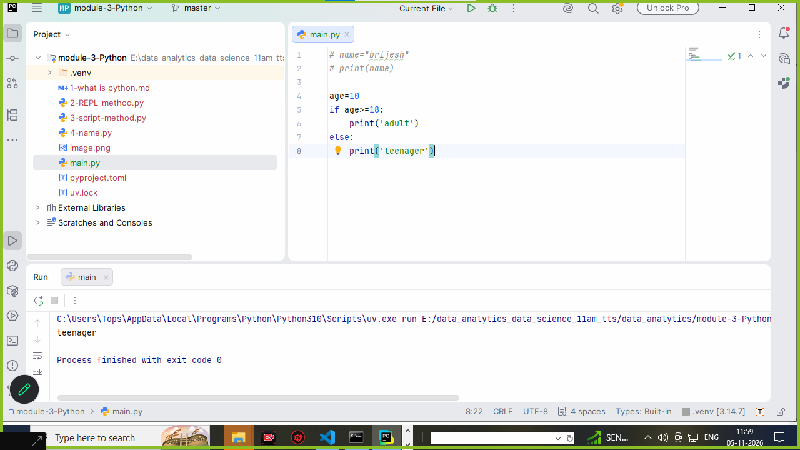
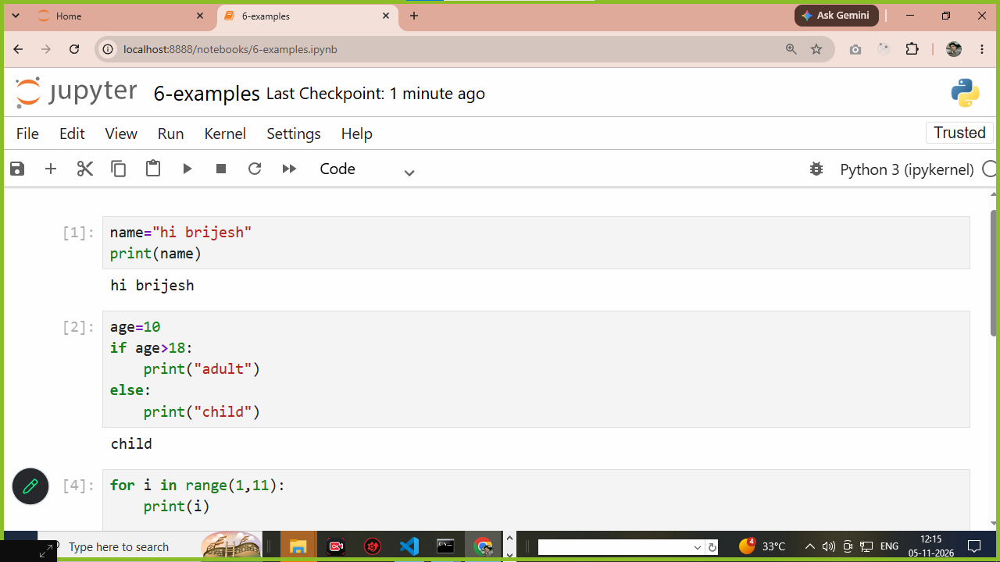

# what is python ? 

1. python is a language 
2. python is interpreter based language 
3. python is most powerful language used for ...

   - web development 
   - machine learning 
   - data analytics 
   - business analytics 
   - data science 
   - agentic ai 
   - generative ai 
   - desktop app development 
   - iot 
   - cyber security

4. python interpreter the programmes step by step checked proggrames and also interpreter convert high level language to binary level language 

5. python is a programming language
6. python used for web development and data analytics and data science also
7. python most powerful language that is again number one positions in language

8. python are used to save with .py file extension 
9. python is also save with .ipynb if we used **jupyter notebook**  
10. python is case-senstive language
   **examples**
   ```
   print()
   or 
   pandas
   or
   calendar
   or 
   class
   or
   numpy 

   ```
11. how to run python 
**there are two method to run python**

    - REPL (read | evaluate | print | loop) method 
    - script method 

12. how to check python is installed or not 

```
E:\data_analytics_data_science_11am_tts\data_analytics\module-3-Python>python
Python 3.14.7 (tags/v3.14.7:823f032, Aug  5 2026, 10:51:32) [MSC v.1944 64 bit (AMD64)] on win32
Type "help", "copyright", "credits" or "license" for more information.

```

13. using script we can save file with .py and write a programmes in python 

**examples**
```
# name='my name is brijesh'
# print(name)

# age=18
# if age>=18:
#     print('i am adult')
# else:
#     print('i am child')

# for i in range(1,51):
#     print(i)

name="meet"
print(name)

```

14. python used some different-2 IDE to run programmes 

    1. VS code
    2. pycharm 
    3. jupyter 

# python run on vs code 



# python run on pycharm 



# python run on jupyter




# what is python module ? 

- if we create any file saved with .py that is called module in python
- we saved any file with **examples.py** 
- we create file named with **test.py** is also called module in python

# types of module in python ?
1. user defined module
2. default module or pre-defined module
3. third party module 

**examples of user defined modules**

```
# which defined by users with the name of **examples.py**
# w.a.p to print your name take input from users

name=input("Enter your name here : ")
print("your name is :",name)

```
**examples of  pre-defined modules**

```
# inbuilt modules python provides inbuilt that is used by **import** keyword
# inbuilt modules are ...
# examples :math, calendar , requests , os etc

# import calendar
# print(calendar.calendar(2026))

import math
number=2
print(math.pow(number,2))
print(math.pow(number,3))
print(math.pow(number,4))
print(math.pow(number,5))

```

**examples of third party modules**

```
# third party modules are not inbuilt in python 
# third party modules are installable
# third party modules are in form of packages and bundles
# how to install third party modules 
# examples : python pip install modulename 
# examples : python -m pip install pandas numpy seaborn openpyxl
# how to check third party modules are installed or not 
# examples : python -m pip show pandas  
# Name: pandas
# Version: 3.0.5
# Summary: Powerful data structures for data analysis, time series, and statistics
# Home-page: https://pandas.pydata.org
# Author:
# Author-email: The Pandas Development Team <pandas-dev@python.org>
# License: BSD 3-Clause License

import pandas as pd
emp={
    "name":["om","smith","jay","rishikesh","brijesh"],
    "age":[21,22,23,24,35]
}

# pandas create a tabular layout or in dataframes 
df=pd.DataFrame(emp)
print(df)

```

# what is reserved key word in python ?

1. reserved keyword is reserved py python
2. reserved keyword will never assigned are used as variables name
3. how to know reserved keyword list 

**examples**

```
import keyword
print(keyword.kwlist)

['False', 'None', 'True', 'and', 'as', 'assert', 'async', 'await', 'break', 'class', 'continue', 'def', 'del', 'elif', 'else', 'except', 'finally', 'for', 'from', 'global', 'if', 'import', 'in', 'is', 'lambda', 'nonlocal', 'not', 'or', 'pass', 'raise', 'return', 'try', 'while', 'with', 'yield']
```

**examples**

```
# can not be take a variables name as reserved keyword
# raise='my name is om'
# print(raise)

# can be take any name as variables that is not reserved keyword
nm='my name is om'
print(nm)

```